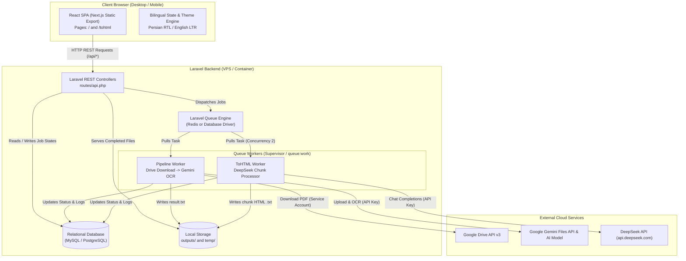

# Technical Audit: PHP Laravel Migration Feasibility Report
## Scope: Core Pipeline (`/`) and HTML Generation (`/tohtml`)

**Date:** October 2026  
**Audited Target:** [app/page.tsx](file:///d:/WePass/automation/app/page.tsx) (Pipeline / OCR Dashboard) & [app/tohtml/page.tsx](file:///d:/WePass/automation/app/tohtml/page.tsx) (Medical Booklet ToHTML Dashboard)  
**Excluded Modules:** `/notebooklm`, `/CRUDnoteBook`, Browser Automation via Playwright / CDP, and interactive Google login CLI.

---

## 1. Executive Summary

### Overall Conclusion: **Feasible with Conditions**

A complete migration of the logic and user-facing workflows originating from the root page [`/`](file:///d:/WePass/automation/app/page.tsx) and the HTML generator page [`/tohtml`](file:///d:/WePass/automation/app/tohtml/page.tsx) to **PHP Laravel** is **technically feasible and architecturally advantageous**, but **unsuitable for basic PHP shared hosting** without dedicated queue worker processes or containerized infrastructure.

### Key Audit Findings

1. **Absence of Browser Automation Blockers:**
   Contrary to expectations set by the presence of `playwright` in `package.json`, **neither [`/`](file:///d:/WePass/automation/app/page.tsx) nor [`/tohtml`](file:///d:/WePass/automation/app/tohtml/page.tsx) uses Playwright, Puppeteer, Chrome DevTools Protocol (CDP), or local browsers.** The browser automation in this repository belongs exclusively to the excluded `/notebooklm` service.
2. **Standard REST & HTTP API Integrations:**
   The backend logic for `/` and `/tohtml` consists entirely of outbound HTTP REST API integrations:
   - **Google Drive API v3** (listing folder contents and downloading PDFs via service account credentials).
   - **Google Gemini API** (uploading PDFs via Files API, polling processing state, executing multimodal OCR via Gemini 3.5 Flash Lite).
   - **DeepSeek API** (OpenAI-compatible REST completions endpoint converting structured text into medical HTML booklets).
   All three APIs have native PHP equivalents and official/standard SDKs or HTTP client implementations (`google/apiclient`, standard Guzzle HTTP, or `openai-php/client`).
3. **Severe Current Architectural Vulnerability (In-Memory State):**
   The current Next.js implementation stores all job states, file statuses, chunking progress, execution logs, and summaries in volatile Node.js memory ([`Pjob.service.ts:61`](file:///d:/WePass/automation/server/services/Pjob.service.ts#L61) and [`toHtmlJob.service.ts:72`](file:///d:/WePass/automation/server/services/toHtmlJob.service.ts#L72)). Server restarts, unhandled crashes, or multi-instance deployments immediately wipe all running and historic jobs. Porting to Laravel with **Eloquent ORM and MySQL/PostgreSQL** eliminates this vulnerability.
4. **The Critical Hosting Constraint (Asynchronous Execution):**
   The current Node.js engine initiates long-running background tasks via fire-and-forget floating promises ([`pipeline.service.ts:53`](file:///d:/WePass/automation/server/services/pipeline.service.ts#L53) and [`toHtmlRunner.service.ts:44`](file:///d:/WePass/automation/app/api/tohtml/start/route.ts#L44)). A single pipeline execution or multi-chunk DeepSeek batch can take between **3 minutes and 45 minutes**. Standard PHP shared hosting enforces strict `max_execution_time` (typically 30–60 seconds) and web request lifecycle termination upon HTTP response delivery.
   **Migration is only viable if the Laravel deployment supports persistent background queue workers (`php artisan queue:work` or Supervisor / Redis / Database Queues).**

---

## 2. Current Architecture

### 2.1 Technology Stack & Versions
- **Frontend:** Next.js 16.2.10 (React 19.2.4), Tailwind CSS v4, Lucide/Inline SVGs, custom Context-based i18n supporting Persian (RTL) and English (LTR).
- **Backend Runtime:** Node.js 20+ with Next.js App Router API Routes (`app/api/pipelines/*` and `app/api/tohtml/*`).
- **Language:** TypeScript 5.x.
- **External API Clients:**
  - `googleapis` (^173.0.0): Google Drive API v3 with GoogleAuth (Service Account JSON).
  - `@google/genai` (^2.30.0): Google Gemini Files API + `models.generateContent`.
  - `openai` (^6.48.0): Configured with `baseURL: "https://api.deepseek.com"` targeting model `deepseek-chat`.
- **Database / Storage:**
  - Database: **None**.
  - In-Memory Maps: `Map<string, PipelineJob>` in [`Pjob.service.ts:61`](file:///d:/WePass/automation/server/services/Pjob.service.ts#L61) and `Map<string, ToHtmlJob>` in [`toHtmlJob.service.ts:72`](file:///d:/WePass/automation/server/services/toHtmlJob.service.ts#L72).
  - File System: Local disk storage in `temp/` (ephemeral PDF downloads) and `outputs/` (sanitized job directories containing OCR results and generated HTML snippets).
- **Authentication / Authorization:** **None**. No user accounts, sessions, CSRF tokens, or route guards exist on either page.

---

### 2.2 Execution Flow: Page `/` (Drive OCR Pipeline)

```
User enters Google Drive Folder URL
               │
               ▼
   [app/page.tsx] (Client Dashboard)
               │ POST /api/pipelines/start { folderUrl }
               ▼
[app/api/pipelines/start/route.ts]
               │ calls pipelineService.start(folderUrl)
               ▼
[server/services/pipeline.service.ts]
   ├── Extracts Folder ID via Regex (line 155)
   ├── Fetches file list from Google Drive v3 via [drive.service.ts:33]
   ├── Instantiates Job in memory via [Pjob.service.ts:63]
   └── Spawns asynchronous job execution: runJob() (line 102)
               │ Returns immediate HTTP 200 { jobId, totalFiles }
               ▼
   Client begins 2s polling via GET /api/pipelines/status?id={jobId}
               │
   [Async Worker: pipeline.worker.ts] (Concurrency = 1)
   For each file in Drive Folder:
      1. Download PDF to temp/{fileId}.pdf via drive.files.get (stream)
      2. Upload PDF to Google Gemini Files API (ai.files.upload)
      3. Poll Gemini Files API until state == ACTIVE
      4. Call ai.models.generateContent with OCR_PROMPT
      5. Delete remote file from Gemini Files API (ai.files.delete)
      6. Write extracted text to outputs/{sanitized_name}/result.txt
      7. Remove local temp/{fileId}.pdf
      8. Update in-memory job status, file status, and logs
               │
               ▼
   User downloads single OCR txt via GET /api/pipelines/download
   OR merges all succeeded outputs via GET /api/pipelines/merge
```

---

### 2.3 Execution Flow: Page `/tohtml` (Medical Booklet HTML Synthesis)

```
User selects .txt file containing medical notes with "CUT n" markers
               │
               ▼
   [app/tohtml/page.tsx] (Client Dashboard)
   ├── Client-side text extraction (selected.text())
   ├── parseCutSections(rawText) [server/lib/cutParser.ts]
   │     Splits content by delimiter: /(?:^|\r?\n)...CUT\s+(\d+)/gi
   │     Preserves preamble and sections
   ├── splitByLines(sec.content, 600) [server/lib/splitByLines.ts]
   │     Calculates chunking breakdown (up to 600 lines per chunk)
   └── User clicks "Run Processing"
               │ POST /api/tohtml/start { fileName, prompt, sections }
               ▼
[app/api/tohtml/start/route.ts]
   ├── createToHtmlJob() [server/services/toHtmlJob.service.ts:74]
   │     Pre-allocates chunks into Map<string, ToHtmlJob>
   └── runToHtmlJob() [server/services/toHtmlRunner.service.ts:161]
               │ Returns immediate HTTP 200 { jobId, totalChunks }
               ▼
   Client begins 2s polling via GET /api/tohtml/status?id={jobId}
               │
   [Async Worker: toHtmlRunner.service.ts] (Concurrency = 2)
   For each pending chunk:
      1. Prepare user prompt: "Process the following section ({label}):\n\n{content}"
      2. Call deepseekChat(systemPrompt, userPrompt) [deepseek.service.ts:18]
      3. Format response into HTML booklet structure
      4. Save to outputs/tohtml-{baseName}/{index}-{marker}-chunk-{num}.txt
      5. Update in-memory chunk status, durationMs, and logs
               │
               ▼
   User can retry failed chunks via POST /api/tohtml/retry
   User inspects live previews / modal logs
   User downloads individual chunk txt or merged file via GET /api/tohtml/download
```

---

## 3. Component Compatibility Matrix

| Component / Functionality | Current Technology | Laravel / PHP Compatibility | Migration Strategy | Difficulty | Risk |
|---|---|---|---|---|---|
| **Pipeline Frontend UI (`/`)** | Next.js 16 (React 19), Tailwind CSS v4, Context i18n | **Compatible** | Maintain React SPA or compile static build (`next export`) talking to Laravel REST API; or rebuild with Blade/Livewire | Medium | Low |
| **ToHTML Frontend UI (`/tohtml`)** | Next.js 16 (React 19), Client Parser, Modal Inspector | **Compatible** | Same as above. Can run unchanged as a decoupled frontend consuming Laravel `/api/*` endpoints | Medium | Low |
| **Bilingual Support (FA/EN, RTL/LTR)** | `LanguageContext.tsx`, `translations.ts` | **Compatible** | Keep on client side or map to Laravel `lang/fa` and `lang/en` dictionaries | Low | Low |
| **CUT Parser (`cutParser.ts`)** | TypeScript regex parser ([`cutParser.ts:46`](file:///d:/WePass/automation/server/lib/cutParser.ts#L46)) | **Reimplementable** | Port regex and string slicing to a PHP Service class (`CutParserService.php`) | Low | Low |
| **Line-based Chunker (`splitByLines.ts`)** | TypeScript array chunker ([`splitByLines.ts:5`](file:///d:/WePass/automation/server/lib/splitByLines.ts#L5)) | **Reimplementable** | Trivial port to PHP using `preg_split('/\r?\n/', $text)` and `array_chunk()` | Low | Low |
| **Drive Folder Fetch & Download** | `googleapis` (Drive v3, Service Account) | **Replaceable** | Replace with official `google/apiclient` package via Composer. Service Account authentication is identical | Medium | Low |
| **Gemini Multimodal OCR** | `@google/genai` (Files API + GenerateContent) | **Reimplementable** | Google Gemini API has standard REST endpoints. Use Guzzle HTTP or community PHP SDK for Files upload & generation | Medium | Medium |
| **DeepSeek Chat API** | `openai` NPM package with custom `baseURL` | **Replaceable** | Replace with `openai-php/client` or Guzzle HTTP pointing to `https://api.deepseek.com` | Low | Low |
| **Job & File State Tracking** | In-Memory `Map<string, Job>` | **Replaceable** | Replace with Eloquent Models (`Job`, `JobFile`, `JobSection`, `JobLog`) backed by MySQL/PostgreSQL | Medium | Low (Major Improvement) |
| **Asynchronous Job Execution** | Floating Node.js Promises (`void runJob()`) | **Replaceable** | Port to Laravel Queued Jobs (`ProcessDrivePipelineJob`, `ProcessDeepSeekChunkJob`) with Redis/Database driver | Medium | Medium |
| **Retry & Rate-Limit Pacing** | Custom TS `retry()` ([`retry.ts:36`](file:///d:/WePass/automation/server/retry.ts#L36)) & Pacing chain | **Replaceable** | Utilize native Laravel Job retries (`public $tries = 5;`, `public $backoff = [5, 10, 20];`) and `RateLimiter` | Low | Low |
| **File Storage & Output Sanitation** | Node.js `fs/promises` & `path.resolve` | **Replaceable** | Replace with Laravel `Storage::disk('outputs')` and `Storage::disk('temp')` | Low | Low |
| **File Merging & Downloads** | Node.js file streaming & HTTP Content-Disposition | **Replaceable** | Replace with Laravel `response()->download()` and `response()->streamDownload()` | Low | Low |

---

## 4. Hosting Requirements Assessment

### Scenario Comparison

| Feature / Requirement | Scenario A: Basic PHP Shared Hosting | Scenario B: Managed Laravel Hosting (with Worker Support) | Scenario C: VPS / Container (Docker / Cloud Run) |
|---|---|---|---|
| **Laravel Web API & Routes** | Full Support | Full Support | Full Support |
| **Existing React Frontend** | Supported (Static export in `public_html`) | Supported | Supported (Node.js or Nginx static container) |
| **Database (MySQL / Postgres)** | Supported (cPanel MySQL) | Supported | Supported |
| **Google Drive / Gemini / DeepSeek HTTP Calls** | Supported (Outbound HTTPS port 443 must be open) | Supported | Supported |
| **Execution Time Limits** | **Fatal Blocker** (`max_execution_time` 30–60s) | Configurable / Bypassed via Queues | Unlimited for worker processes |
| **Persistent Queue Workers (`queue:work`)** | **Incompatible / Highly Unreliable** (cron hacks only) | **Full Support** (Supervisor / Forge / Cloud Queues) | **Full Support** (Docker daemon or systemd Supervisor) |
| **Concurrency Control (`p-limit` / Set)** | Incompatible within single request | Native Queue Workers (`--concurrency=2`) | Native Queue Workers |
| **Long Polling / WebSockets** | Limited | Supported | Supported |
| **Overall Verdict** | **NOT RECOMMENDED / UNSUITABLE** | **RECOMMENDED** | **HIGHLY RECOMMENDED** |

### Critical Detailed Assessment for Scenario A (Basic Shared Hosting)
On shared hosting (e.g., standard cPanel, shared Apache/PHP-FPM):
1. **Request Timeout:** An OCR pipeline processing 10 Drive files with Gemini (including 10s pacing and polling) takes 5 to 15 minutes. A DeepSeek job processing 30 chunks takes 10 to 25 minutes. A web request in shared hosting will be killed with `504 Gateway Timeout` or `Maximum execution time of 30 seconds exceeded`.
2. **Worker Absence:** Shared hosting rarely allows background daemon processes like `php artisan queue:work`. While some developers attempt to run queue workers via cron (`* * * * * php artisan queue:work --stop-when-empty`), this introduces a 60-second dispatch latency per batch and frequently suffers from overlapping process lockups and memory kills.

**Conclusion:** Migration to Laravel is **strictly contingent on having a hosting environment that supports long-running queue workers (VPS, AWS/DigitalOcean droplet, Laravel Forge, Vapor, or Docker containers).**

---

## 5. API Integration Assessment

### 5.1 Google Drive API v3
- **Purpose:** Enumerate files in a user-provided folder URL and download PDF source documents.
- **Authentication:** Service Account JWT ([`drive.service.ts:8-23`](file:///d:/WePass/automation/server/services/drive.service.ts#L8-L23)) using `GOOGLE_CLIENT_EMAIL` and `GOOGLE_PRIVATE_KEY`.
- **PHP Replacement:** `google/apiclient:^2.15`.
  ```php
  $client = new \Google\Client();
  $client->setAuthConfig([
      'client_email' => config('services.google.client_email'),
      'private_key'  => config('services.google.private_key'),
  ]);
  $client->addScope(\Google\Service\Drive::DRIVE_READONLY);
  $service = new \Google\Service\Drive($client);
  ```
- **Feasibility:** 100% compatible. Protocol and credentials remain completely identical.

### 5.2 Google Gemini API (Multimodal OCR)
- **Purpose:** Two-step extraction process:
  1. Upload PDF binary to Gemini Files API (`ai.files.upload`) and poll until state is `ACTIVE` ([`gemini.service.ts:165-200`](file:///d:/WePass/automation/server/services/AI/gemini.service.ts#L165-L200)).
  2. Generate structured question content with model `gemini-3.5-flash-lite` using `OCR_PROMPT` ([`gemini.service.ts:220-250`](file:///d:/WePass/automation/server/services/AI/gemini.service.ts#L220-L250)).
  3. Delete file on Gemini servers (`ai.files.delete`).
- **PHP Replacement:** Standard Guzzle HTTP client calls to Google Gemini REST endpoints (`https://generativelanguage.googleapis.com/upload/v1beta/files` and `https://generativelanguage.googleapis.com/v1beta/models/{model}:generateContent?key={apiKey}`).
- **Feasibility:** Fully compatible via REST. Pacing intervals (`GEMINI_MIN_INTERVAL_MS = 10000`) and exponential backoff retry are natively supported in Laravel Queues via delay mechanisms (`$this->release(10)`).

### 5.3 DeepSeek API (HTML Booklet Synthesis)
- **Purpose:** Submits chunks of medical study text along with a large, detailed system prompt (`DEFAULT_PROMPT`, ~600 lines) to `deepseek-chat` to output clean HTML documents.
- **PHP Replacement:** `openai-php/client` or Guzzle HTTP.
  ```php
  $client = OpenAI::factory()
      ->withBaseUri('https://api.deepseek.com')
      ->withApiKey(config('services.deepseek.api_key'))
      ->make();

  $response = $client->chat()->create([
      'model' => 'deepseek-chat',
      'temperature' => 0,
      'max_tokens' => (int) config('services.deepseek.max_tokens', 16384),
      'messages' => [
          ['role' => 'system', 'content' => $systemPrompt],
          ['role' => 'user', 'content' => $userPrompt],
      ],
  ]);
  ```
- **Feasibility:** 100% compatible. DeepSeek uses standard OpenAI API specifications.

---

## 6. Database and Data Migration

### Current State
There is **no database** to migrate. All job information currently vanishes on application restart.

### Proposed Relational Schema for Laravel (MySQL / PostgreSQL / SQLite)

Moving to Laravel provides an immediate architectural upgrade by persisting jobs to a relational database:

```sql
-- 1. Pipeline Jobs Table
CREATE TABLE pipeline_jobs (
    id CHAR(36) PRIMARY KEY,
    folder_id VARCHAR(255) NOT NULL,
    status ENUM('queued', 'processing', 'completed', 'failed') NOT NULL DEFAULT 'queued',
    total_files INT NOT NULL DEFAULT 0,
    created_at TIMESTAMP NULL,
    updated_at TIMESTAMP NULL
);

-- 2. Pipeline Job Files Table
CREATE TABLE pipeline_job_files (
    id CHAR(36) PRIMARY KEY,
    job_id CHAR(36) NOT NULL,
    file_id VARCHAR(255) NOT NULL,
    file_name VARCHAR(255) NOT NULL,
    download_status VARCHAR(50) DEFAULT 'pending',
    upload_status VARCHAR(50) DEFAULT 'pending',
    ocr_status VARCHAR(50) DEFAULT 'pending',
    overall_status ENUM('pending', 'in_progress', 'success', 'error') NOT NULL DEFAULT 'pending',
    duration_ms INT NULL,
    output_filename VARCHAR(255) NULL,
    output_path VARCHAR(500) NULL,
    error_message TEXT NULL,
    started_at TIMESTAMP NULL,
    completed_at TIMESTAMP NULL,
    FOREIGN KEY (job_id) REFERENCES pipeline_jobs(id) ON DELETE CASCADE
);

-- 3. ToHtml Jobs Table
CREATE TABLE tohtml_jobs (
    id CHAR(36) PRIMARY KEY,
    file_name VARCHAR(255) NOT NULL,
    folder_name VARCHAR(255) NOT NULL,
    system_prompt MEDIUMTEXT NOT NULL,
    status ENUM('queued', 'processing', 'completed', 'failed') NOT NULL DEFAULT 'queued',
    total_sections INT NOT NULL DEFAULT 0,
    total_chunks INT NOT NULL DEFAULT 0,
    created_at TIMESTAMP NULL,
    started_at TIMESTAMP NULL,
    completed_at TIMESTAMP NULL
);

-- 4. ToHtml Sections / Chunks Table
CREATE TABLE tohtml_job_chunks (
    id CHAR(36) PRIMARY KEY,
    job_id CHAR(36) NOT NULL,
    chunk_index INT NOT NULL,
    section_index INT NOT NULL,
    marker VARCHAR(100) NOT NULL,
    label VARCHAR(255) NOT NULL,
    content MEDIUMTEXT NOT NULL,
    char_count INT NOT NULL,
    line_count INT NOT NULL,
    status ENUM('pending', 'processing', 'completed', 'failed') NOT NULL DEFAULT 'pending',
    output_filename VARCHAR(255) NULL,
    duration_ms INT NULL,
    error_message TEXT NULL,
    created_at TIMESTAMP NULL,
    completed_at TIMESTAMP NULL,
    FOREIGN KEY (job_id) REFERENCES tohtml_jobs(id) ON DELETE CASCADE
);

-- 5. Unified Activity Logs Table
CREATE TABLE job_logs (
    id BIGINT UNSIGNED AUTO_INCREMENT PRIMARY KEY,
    job_type ENUM('pipeline', 'tohtml') NOT NULL,
    job_id CHAR(36) NOT NULL,
    level ENUM('INFO', 'WARN', 'ERROR') NOT NULL,
    stage VARCHAR(50) NULL,
    message TEXT NOT NULL,
    context JSON NULL,
    created_at TIMESTAMP DEFAULT CURRENT_TIMESTAMP,
    INDEX (job_id, created_at)
);
```

---

## 7. Security Assessment

### 7.1 External API Key Handling
1. **Server-Side Secrets:** Currently, `GEMINI_API_KEY`, `DEEPSEEK_API_KEY`, and `GOOGLE_PRIVATE_KEY` reside in `.env`. They are never exposed to the frontend bundle. In Laravel, these will map directly to `config/services.php` and `.env`.
2. **User-Supplied API Keys (Requirement Analysis):**
   If users supply their own keys in the web UI:
   - **Do not store unencrypted keys in a database.** Use Laravel's `Crypt::encryptString()` for encryption at rest.
   - **Ephemeral In-Memory Option:** Pass user keys as request headers (e.g., `X-User-DeepSeek-Key`) attached to the queued job payload, and wipe them after execution.
   - **Multi-Tenant Isolation:** If keys are persisted for registered users, associate them with `user_id` and ensure strict authorization via Laravel Policies.

### 7.2 Filesystem & Path Traversal Safeguards
The existing codebase features robust path sanitization routines:
- [`storage.service.ts:13`](file:///d:/WePass/automation/server/services/storage.service.ts#L13) (`sanitizeFolderName`)
- [`storage.service.ts:57`](file:///d:/WePass/automation/server/services/storage.service.ts#L57) (`jobDir` path traversal check)
- [`toHtmlRunner.service.ts:36`](file:///d:/WePass/automation/server/services/toHtmlRunner.service.ts#L36) (`getJobOutputPath` traversal validation)

In Laravel, filesystem operations should be encapsulated inside a dedicated local disk (`Storage::disk('outputs')`) configured in `config/filesystems.php`. Using Laravel's `Storage::path()` automatically enforces relative paths within the designated storage root, preventing `../` traversal attacks.

### 7.3 UTF-8 Character Encoding & Arabic/Persian BOM
In [`app/lib/download.ts:79`](file:///d:/WePass/automation/app/lib/download.ts#L79), a UTF-8 Byte Order Mark (`\uFEFF`) is prepended to text downloads so that Persian text renders correctly in Windows Notepad and Excel. When serving file downloads from Laravel, the backend response headers must explicitly specify:
```php
return response($bomContent, 200, [
    'Content-Type' => 'text/plain; charset=UTF-8',
    'Content-Disposition' => 'attachment; filename="' . $safeName . '"',
]);
```

---

## 8. Migration Strategies

### Strategy 1: Headless Laravel API + Decoupled React Frontend (Recommended)
- **Concept:** Replace only the Next.js API layer with Laravel. Keep the current Next.js/React frontend as either an export SPA or a separate Next.js service.
- **Pros:**
  - Preserves 100% of the tested, polished Persian/English UI, theme toggling, live polling, and modal interactions without rewriting complex React components.
  - Minimal migration risk. Only backend services and routes need porting.
  - Clear separation of concerns.
- **Cons:** Two projects to deploy if running separately, or requires building Next.js into Laravel's `public/` directory.

### Strategy 2: Complete Rewrite to Laravel (Blade + Livewire / Alpine.js)
- **Concept:** Rebuild both frontend pages ([`app/page.tsx`](file:///d:/WePass/automation/app/page.tsx) and [`app/tohtml/page.tsx`](file:///d:/WePass/automation/app/tohtml/page.tsx)) using Laravel Blade templates, Alpine.js, and Livewire for polling/reactivity.
- **Pros:** Unified single-framework repository. No Node.js build process in production.
- **Cons:** Substantial frontend rewriting effort (~2,500 lines of complex React/TypeScript UI code across filters, theme state, language context, and modals). High risk of visual or behavioral regressions.

### Strategy 3: Monolithic Laravel with Inertia.js + React
- **Concept:** Retain the React components but render them via Laravel Inertia.js instead of Next.js App Router.
- **Pros:** Retains React components while keeping routing and controllers completely inside Laravel.
- **Cons:** Requires refactoring data-fetching hooks from client `fetch()` to Inertia page props and partial reloads.

### Strategy 4: Keep Existing Next.js Stack (Status Quo)
- **Concept:** Do not migrate to Laravel. Deploy the current Next.js application on a VPS using PM2 or Docker, adding an SQLite/PostgreSQL database for persistence.
- **Pros:** Zero code rewrite; immediate readiness.
- **Cons:** Does not meet the objective if company-wide standardization on PHP/Laravel hosting is mandatory.

---

## 9. Cost and Effort Estimates (Strategy 1: Headless Laravel API)

*Estimates assume an experienced full-stack Laravel developer familiar with Google APIs and LLM integrations.*

| Phase / Task | Scope | Developer Hours | Calendar Time |
|---|---|---|---|
| **1. Database Schema & Models** | Migrations, Eloquent Models, Relationships, Factories | 6 – 10 hrs | 1 – 2 days |
| **2. Core Service Ports** | `CutParserService`, `LineSplitterService`, `StorageService` | 6 – 8 hrs | 1 day |
| **3. API Client Integrations** | Google Drive v3 Client, Gemini REST client, DeepSeek client | 12 – 16 hrs | 2 – 3 days |
| **4. Queue Jobs & Workers** | `ProcessDrivePipelineJob`, `ProcessDeepSeekChunkJob`, rate limiting | 12 – 18 hrs | 2 – 3 days |
| **5. REST Controllers & Routes** | Porting `/api/pipelines/*` and `/api/tohtml/*` endpoints | 8 – 12 hrs | 1 – 2 days |
| **6. Frontend Adaptation** | Base URL configuration, testing client compatibility | 4 – 6 hrs | 1 day |
| **7. End-to-End Integration Testing** | Full folder OCR tests, large-chunk medical note processing | 12 – 16 hrs | 2 – 3 days |
| **Total Estimated Effort** | | **60 – 86 hrs** | **2 – 3 weeks** |

### Factors That Could Increase Effort:
- Requiring a full frontend rewrite into Blade/Livewire (+40–60 hours).
- Adding complex multi-user authentication and per-user encrypted API key vaults (+20–30 hours).
- Attempting to force background jobs onto low-cost shared hosting with custom cron workarounds (+20 hours of debugging).

---

## 10. Risks and Potential Blockers

| Risk | Severity | Mitigation Strategy |
|---|---|---|
| **Hosting Without Daemon Support** | **CRITICAL** | Confirm hosting environment supports `php artisan queue:work` or Supervisor before beginning. Avoid basic shared hosting. |
| **Gemini Rate Limits (429 Quota)** | **HIGH** | Replicate current pacing logic ([`gemini.service.ts:89`](file:///d:/WePass/automation/server/services/AI/gemini.service.ts#L89)) using Laravel Queue delays (`$this->release(10)`) or Redis rate limiters. |
| **Large File / Memory Limits** | **MEDIUM** | Configure PHP `memory_limit = 512M` and stream Drive file downloads directly to disk using Guzzle `sink` parameter rather than loading into memory. |
| **Client-Side Regex Differences** | **LOW** | Ensure PCRE regex in PHP `preg_match_all` for `CUT n` replicates JavaScript `/gi` behavior identically, including CRLF line endings. |
| **Character Encoding Corruption** | **LOW** | Validate that MySQL database collation is `utf8mb4_unicode_ci` and explicitly inject UTF-8 BOM on file downloads. |

---

## 11. Recommended Architecture

### Component Placement & Communication Diagram



---

## 12. Migration Roadmap

### Phase 1: Laravel Foundation & Database Layer
- **Objective:** Initialize Laravel project, configure database connection, and establish data persistence.
- **Affected Components:** Create migrations for `pipeline_jobs`, `pipeline_job_files`, `tohtml_jobs`, `tohtml_job_chunks`, and `job_logs`.
- **Validation:** Run migrations and verify schema constraints in MySQL.

### Phase 2: Domain Services Porting
- **Objective:** Port core utility and text-processing logic from TypeScript to PHP.
- **Affected Components:**
  - Create `App\Services\CutParserService` (porting [`cutParser.ts`](file:///d:/WePass/automation/server/lib/cutParser.ts)).
  - Create `App\Services\LineSplitterService` (porting [`splitByLines.ts`](file:///d:/WePass/automation/server/lib/splitByLines.ts)).
  - Create `App\Services\FileStorageService` (porting [`storage.service.ts`](file:///d:/WePass/automation/server/services/storage.service.ts)).
- **Validation:** Write PHPUnit test cases mirroring existing test inputs to ensure delimiter parsing and line splitting match character-for-character.

### Phase 3: External API Integration & Clients
- **Objective:** Implement authenticated API clients.
- **Affected Components:**
  - Install `google/apiclient` and configure Google Drive Service Account authentication.
  - Implement `GeminiOcrService` using Guzzle HTTP for file upload, polling, and content generation.
  - Implement `DeepSeekService` using `openai-php/client` or custom Guzzle handler.
- **Validation:** Execute standalone test commands to download a sample Drive PDF, extract OCR text via Gemini, and generate a sample HTML section via DeepSeek.

### Phase 4: Queue Jobs & Concurrency Engine
- **Objective:** Build background job handlers replacing Node.js unhandled floating promises.
- **Affected Components:**
  - Create `App\Jobs\ProcessDrivePipelineJob` with sequential file processing and cleanup.
  - Create `App\Jobs\ProcessToHtmlChunkJob` with rate limiting and retry handling.
- **Validation:** Dispatch simulated jobs and verify status transitions (`queued` -> `processing` -> `completed`/`failed`) and log insertions.

### Phase 5: API Controllers & Route Mapping
- **Objective:** Expose identical REST endpoints matching the current Next.js routes.
- **Affected Components:**
  - `POST /api/pipelines/start` -> `PipelineController@start`
  - `GET /api/pipelines/status` -> `PipelineController@status`
  - `GET /api/pipelines/download` -> `PipelineController@download`
  - `GET /api/pipelines/merge` -> `PipelineController@merge`
  - `POST /api/tohtml/start` -> `ToHtmlController@start`
  - `GET /api/tohtml/status` -> `ToHtmlController@status`
  - `POST /api/tohtml/retry` -> `ToHtmlController@retry`
  - `GET /api/tohtml/download` -> `ToHtmlController@download`
- **Validation:** Ensure request payloads and JSON response structures match existing TypeScript interfaces in [`app/page.tsx`](file:///d:/WePass/automation/app/page.tsx) and [`app/tohtml/page.tsx`](file:///d:/WePass/automation/app/tohtml/page.tsx).

### Phase 6: Frontend Integration & End-to-End Verification
- **Objective:** Connect the existing React dashboard to the Laravel backend.
- **Affected Components:** Configure Next.js API proxy or update client fetch URLs to point to the Laravel host.
- **Validation:** Perform complete end-to-end user journeys on both `/` and `/tohtml`, verifying polling, progress metrics, Persian RTL rendering, and download integrity.

---

## 13. Final Decision

### 1. Can the project migrate to Laravel?
**Yes.** For the audited scope (page `/` and page `/tohtml`), all backend operations consist of standard API calls, text parsing, file handling, and status tracking. There are no language-exclusive features preventing a complete, clean port to PHP Laravel.

### 2. Can it run on ordinary PHP shared hosting?
**No.** Basic shared hosting lacks persistent queue workers and terminates web requests exceeding 30–60 seconds. Because pipeline OCR and multi-chunk DeepSeek synthesis take several minutes to complete, basic shared hosting will result in gateway timeouts and killed processes.

### 3. Can the frontend remain unchanged?
**Yes.** The frontend consists entirely of Client Components communicating over clean REST endpoints. It can be compiled as a static client application or maintained in Next.js, pointing directly to Laravel API routes without altering its UI logic or styling.

### 4. Which components must be rewritten?
All server-side TypeScript files under `server/services/`, `server/workers/`, and `app/api/` must be rewritten in PHP (Models, Controllers, Services, and Queue Jobs).

### 5. Which components should remain in their existing runtime?
The React frontend components ([`app/page.tsx`](file:///d:/WePass/automation/app/page.tsx), [`app/tohtml/page.tsx`](file:///d:/WePass/automation/app/tohtml/page.tsx), [`LanguageContext.tsx`](file:///d:/WePass/automation/app/context/LanguageContext.tsx), and translations) should remain in React/TypeScript to avoid unnecessary, high-risk UI rewrites.

### 6. Is a hybrid architecture preferable?
**Yes.** A hybrid architecture consisting of a **decoupled React SPA frontend** communicating with a **Laravel REST API + Queue worker backend** is the lowest-risk and highest-quality architecture.

### 7. What is the lowest-risk deployment option?
Deploying the Laravel API and Queue Worker on a **managed VPS or Docker container** (e.g., DigitalOcean Droplet, Hetzner, AWS Lightsail, or Laravel Forge) with Supervisor managing `php artisan queue:work`, and serving the React frontend as static assets.

### 8. What information is still needed from the hosting provider?
Before selecting a hosting package, the provider must confirm:
1. Support for background daemon processes or Supervisor for `php artisan queue:work`.
2. Outbound network access on HTTPS (port 443) to `googleapis.com` and `api.deepseek.com`.
3. Minimum PHP memory limit of at least 256MB–512MB for handling large PDF streams.
4. SSH or CLI access for running Artisan commands and migrations.

### 9. What is your final recommendation, and why?
**Adopt Strategy 1 (Headless Laravel API with Persistent Queues).**  
This path delivers the core architectural benefits of Laravel—robust relational persistence, enterprise-grade queue management, and structured service layers—while eliminating the fragility of Node.js in-memory maps, all without wasting effort rewriting over 2,500 lines of custom, verified Persian RTL frontend code.
