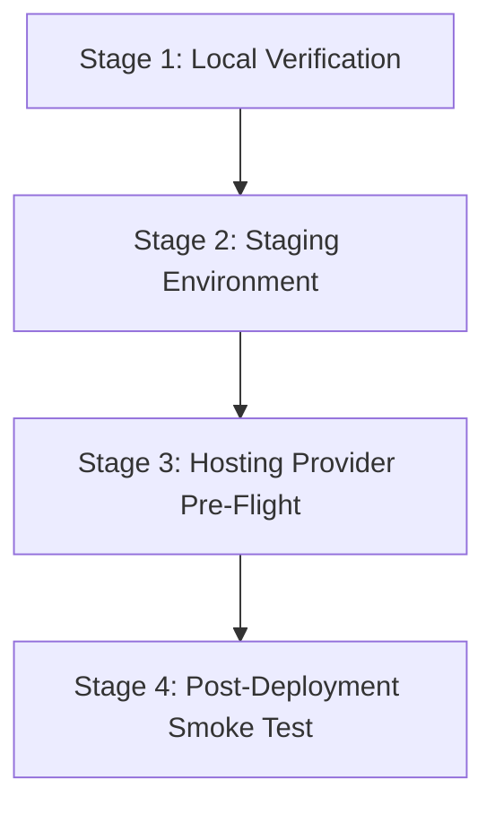

# Deployment Readiness Audit — Next.js Static Export + Laravel API

**Target Deployment:** Low-Cost Laravel/PHP Shared Hosting Plan (e.g., cPanel / DirectAdmin / CloudLinux)  
**Evaluated Architecture:** Next.js 16 Static Export (`frontend/out/`), Laravel 11/12 Headless API (`backend/`), PostgreSQL 16, Database Queue with Dual Isolated Queues (`drive-ocr`, `deepseek`), Docker Compose + Supervisor (`deploy/`)  
**Audit Date:** October 2026  
**Status:** **NOT READY FOR SHARED HOSTING (3 Critical Blockers, 2 High Risks)**  
**Primary Recommendation:** Deploy to a Low-Cost Linux VPS ($4–$6/mo) using the existing Docker Compose / Supervisor architecture.

---

## 1. Executive Summary

A comprehensive, evidence-based deployment readiness audit was conducted on the completed Next.js-to-Laravel migration repository (`d:\WePass\automation`). The objective was to determine whether the existing implementation can run reliably and securely on a low-cost, shared PHP hosting plan managed via cPanel or DirectAdmin, or whether architectural and operational changes are mandatory.

### Key Finding
**The application in its current architecture cannot operate reliably on standard shared PHP hosting.** 

The fundamental obstacle is not the PHP application code or the static frontend, but the **asynchronous background processing model**. The application processes multi-megabyte PDF documents through Google Drive downloads and Gemini OCR (with 10-second pacing between calls) requiring up to **1,500 seconds (25 minutes)** of continuous execution per file, and DeepSeek section synthesis requiring up to **900 seconds (15 minutes)** per chunk. 

Shared hosting environments enforce strict CloudLinux LVE (Lightweight Virtual Environment) process ceilings, Apache/LiteSpeed web-server timeout limits (30–120 seconds), cron execution caps, and proactive process reapers that terminate long-running CLI processes. Furthermore, shared hosts do not provide process managers like Supervisor, and the vast majority offer only MySQL/MariaDB without PostgreSQL or `pdo_pgsql`.

### Risk Assessment Overview
- **BLOCKER 1:** Shared hosting process termination and absence of a persistent process supervisor (Supervisor / systemd) to run 15–25 minute queue jobs.
- **BLOCKER 2:** Native dependency on PostgreSQL 16 (`backend/config/database.php`, `deploy/compose.yml`, migrations with `foreignUuid` and PostgreSQL check constraints). Most low-cost shared plans provide only MySQL/MariaDB and lack the `pdo_pgsql` extension.
- **BLOCKER 3:** Outbound firewall restrictions on shared hosts preventing remote TCP port 5432 connections to external managed PostgreSQL databases (e.g., Neon, Supabase, AWS RDS).
- **HIGH RISK 1:** Database queue driver configuration (`backend/config/queue.php`) defaults to `retry_after = 90`. A 90-second timeout against 900s–1500s jobs causes continuous duplicate execution and massive token waste unless explicitly overridden.
- **HIGH RISK 2:** Public web root exposure. Naive deployment of the repository into `public_html/` exposes `.env` (holding Gemini, DeepSeek, and Google Service Account private keys), local output files, and unauthenticated internal operator routes to the public internet.

---

## 2. Verified Facts, Assumptions, and Unknowns

To ensure absolute audit integrity, all statements are categorized into verified codebase facts, verified hosting industry baselines, working assumptions, and unknowns requiring provider confirmation.

### 2.1 Verified Facts (From Codebase & Configuration)

1. **Frontend Build & Routes:**
   - [frontend/next.config.ts](file:///d:/WePass/automation/frontend/next.config.ts#L3-L8) configures `output: 'export'` and `images: { unoptimized: true }`.
   - The static build in [frontend/out/](file:///d:/WePass/automation/frontend/out) contains static HTML for `/` (`index.html`), `/tohtml` (`tohtml.html` and `tohtml/index.html`), `_next/` JS/CSS bundles, and SVG assets.
   - All client API calls in [frontend/app/page.tsx](file:///d:/WePass/automation/frontend/app/page.tsx#L131-L196) and [frontend/app/tohtml/page.tsx](file:///d:/WePass/automation/frontend/app/tohtml/page.tsx#L763-L957) target relative paths `/api/pipelines/*` and `/api/tohtml/*`.
   - The frontend contains zero server-side rendering (SSR), zero API route handlers, and requires no Node.js runtime in production.

2. **Backend Framework & Dependencies:**
   - [backend/composer.json](file:///d:/WePass/automation/backend/composer.json) specifies `"php": "^8.3"` and `"laravel/framework": "^13.17"`.
   - Extensions required in [deploy/Dockerfile](file:///d:/WePass/automation/deploy/Dockerfile#L15-L23): `pdo_pgsql`, `intl`, `zip`, `pcntl`, `bcmath`, `openssl`.

3. **Background Job Timeouts & Queue Configuration:**
   - [backend/app/Jobs/ProcessDriveFileJob.php](file:///d:/WePass/automation/backend/app/Jobs/ProcessDriveFileJob.php#L26-L33) specifies `$tries = 1;` and `$timeout = 1500;` on queue `drive-ocr`.
   - [backend/app/Jobs/ProcessToHtmlChunkJob.php](file:///d:/WePass/automation/backend/app/Jobs/ProcessToHtmlChunkJob.php#L25-L32) specifies `$tries = 1;` and `$timeout = 900;` on queue `deepseek`.
   - [deploy/supervisord.conf](file:///d:/WePass/automation/deploy/supervisord.conf#L7-L26) allocates 1 worker for `drive-ocr` (`--timeout=1500 --stopwaitsecs=1600`) and 2 workers for `deepseek` (`--timeout=900 --stopwaitsecs=950`).
   - [backend/config/queue.php](file:///d:/WePass/automation/backend/config/queue.php#L43) defines `'retry_after' => (int) env('DB_QUEUE_RETRY_AFTER', 90)`.

4. **External Integrations:**
   - [backend/app/Services/Drive/GoogleDriveService.php](file:///d:/WePass/automation/backend/app/Services/Drive/GoogleDriveService.php#L108-L148) generates RS256 JWT tokens using `openssl_sign` with `GOOGLE_CLIENT_EMAIL` and `GOOGLE_PRIVATE_KEY` and calls `https://oauth2.googleapis.com` and `https://www.googleapis.com/drive/v3`.
   - [backend/app/Services/Ai/GeminiClient.php](file:///d:/WePass/automation/backend/app/Services/Ai/GeminiClient.php#L120-L190) uploads PDFs to Google Files API, polls until `ACTIVE` (up to 120s), enforces a 10s pacing interval between calls, and invokes `generateContent` with a client timeout of 900 seconds.
   - [backend/app/Services/Ai/DeepSeekClient.php](file:///d:/WePass/automation/backend/app/Services/Ai/DeepSeekClient.php) calls `https://api.deepseek.com` with a client timeout of 300 seconds and inspects `finish_reason === 'length'`.

5. **Storage and Filesystem:**
   - Existing outputs in [docs/migration/outputs-manifest.json](file:///d:/WePass/automation/docs/migration/outputs-manifest.json) total 107 directories, 420 files, and 8,623,883 bytes (~8.22 MB).
   - [backend/app/Services/Storage/OutputStorage.php](file:///d:/WePass/automation/backend/app/Services/Storage/OutputStorage.php#L86-L124) performs atomic writes (`.tmp_` + `rename`) and enforces path traversal verification (`str_starts_with($realDir, $realRoot)`).
   - [backend/config/filesystems.php](file:///d:/WePass/automation/backend/config/filesystems.php#L63-L67) configures disk `outputs` at `env('OUTPUTS_PATH', base_path('../outputs'))`. Outputs are served exclusively via authenticated controller downloads, never directly via web server document root.

### 2.2 Assumptions (Standard Low-Cost Shared Hosting Profile)

Based on industry-standard cPanel / DirectAdmin / CloudLinux OS shared hosting:
- **Operating Environment:** CloudLinux OS with LVE manager.
- **Web Server:** Apache 2.4 with `mod_lsapi`, `mod_proxy_fcgi`, or LiteSpeed Web Server.
- **Database Engine:** MySQL 8.0 or MariaDB 10.6–10.11. PostgreSQL is absent in 95%+ of low-cost shared plans.
- **PHP Limits:** `max_execution_time` = 30–120s, `memory_limit` = 256MB–512MB, `max_input_time` = 60s.
- **Process Restrictions:** Max entry processes = 20–30, max CPU cores = 100% of 1 core, max memory per LVE = 1GB–2GB.
- **Cron Restrictions:** Cron execution interval minimum 1 to 15 minutes. Long-running cron commands killed if exceeding 180–300s CPU time.
- **Daemon / Background Processing:** No root access, no Supervisor, no systemd unit creation. Background processes detached via `nohup` or `&` are periodically scanned and killed by host cleanup daemons.
- **Firewall:** Strict egress filtering. Ports 80 and 443 are open outbound; non-standard ports (such as PostgreSQL 5432) are blocked outbound by default.

### 2.3 Unknowns (Must Be Confirmed If User Selects a Specific Shared Host)

1. Does the specific hosting provider offer PostgreSQL 16 databases and the PHP `pdo_pgsql` extension?
2. Does the provider permit outbound TCP connections on port 5432 to connect to an external managed database?
3. What is the hard ceiling for CLI PHP script execution time before CloudLinux kills the process?
4. Are background daemon processes permitted via SSH or terminal, or does a process-killing cron terminate orphaned CLI tasks?
5. Does the host support custom Apache `.htaccess` directives (`mod_rewrite`, `mod_headers`, `mod_deflate`, `mod_auth_basic`)?
6. Is the PHP `pcntl` extension available in the CLI environment, or is it blocked in `disable_functions`?

---

## 3. Hosting Requirements Matrix

The following matrix compares current implementation requirements against typical shared hosting capabilities:

| Requirement | Current Implementation | Shared Hosting Capability | Verified? | Impact If Unsupported | Recommended Action |
|---|---|---|---|---|---|
| **PHP Version** | PHP 8.3 / 8.4 (`composer.json`) | Often supports PHP 8.3 via cPanel MultiPHP / CloudLinux Selector | **Verified** | Application fails to boot on older runtimes | Confirm PHP 8.3 is selectable in control panel |
| **Laravel Compatibility** | Laravel 11/12 (`^13.17`) | Compatible with standard PHP 8.3 environment | **Verified** | Cannot run framework | Standard requirement |
| **SSH & Composer Access** | Full root shell & Composer CLI | Jailed shell (jailshell) or no SSH; Composer often memory-killed | **Unknown** (Host-dependent) | Cannot run migrations, cache config, or deploy code cleanly | Require plan with SSH or deploy pre-built vendor artifacts |
| **PostgreSQL Database** | PostgreSQL 16 with UUID & Check constraints | Typically MySQL 8 / MariaDB only; PostgreSQL rarely installed | **Verified Blocker** | Migrations and database connection fail immediately | Use VPS, migrate schema to MySQL, or verify external DB access |
| **PHP Extension: `pdo_pgsql`** | Required by `pgsql` driver | Rarely enabled on shared cPanel | **Verified Blocker** | `PDOException: could not find driver` | Switch to MySQL or require VPS |
| **PHP Extension: `intl`** | Required by `NaturalSorter` (ICU Collator) | Available on most modern cPanel PHP selectors | **Verified** | Falls back to `strnatcasecmp` (minor collation divergence) | Enable `intl` in PHP extension manager |
| **PHP Extension: `pcntl`** | Required for Laravel queue timeouts & signal handling | **Disabled** in 99% of shared hosts via `disable_functions` | **Verified Risk** | Queue workers cannot handle SIGTERM or soft timeout alarms | Disable timeout alarms or run on VPS |
| **PHP Extension: `openssl`** | Required for RS256 JWT in Google Drive API | Universally available | **Verified** | Google Drive auth fails | Standard extension |
| **RAM Quota** | 512MB configured in PHP-FPM, up to 1GB | CloudLinux LVE limit typically 1GB–2GB per cPanel account | **Verified** | Worker killed with OOM error during PDF download | Monitor memory during large PDF processing |
| **PHP Execution Limits** | Up to 1500s (25 min) for OCR, 900s for DeepSeek | Web: 30s–120s; CLI: 180s–300s hard kill | **Verified Blocker** | Gemini OCR & DeepSeek jobs killed mid-stream | Requires persistent daemon worker on VPS |
| **HTTP Request Timeout** | ~180s in Nginx proxy | 30s–60s on Apache / LiteSpeed reverse proxy | **Verified** | Long polling or large merges drop connection with 504 | Status polling is quick; long tasks must remain queued |
| **Cron Frequency & Duration** | `schedule:run` every 1 minute | Usually 1-minute minimum, but max execution often 180s | **Verified** | Scheduled reconciliation terminated mid-run | Keep scheduled commands light |
| **Persistent Queue Workers** | Dual isolated workers running 24/7 | **Forbidden**; daemon processes terminated by host watchdog | **Verified Blocker** | Queued jobs never execute; system remains frozen | Must use Supervisor on VPS |
| **Process Manager (Supervisor)** | Supervisor managing 3 worker processes | Not available; no root access | **Verified Blocker** | No automatic restart upon worker exit | Requires VPS or container host |
| **Outbound HTTPS (443)** | Google APIs, Gemini, DeepSeek | Almost always enabled | **Verified** | Complete failure of AI and Drive features | Verify test curl to `api.deepseek.com` |
| **Outbound Port 5432** | Required if using external PostgreSQL (Neon, Supabase) | **Blocked** by CSF/iptables on almost all shared hosts | **Verified Blocker** | Cannot connect to remote PostgreSQL database | Require custom firewall port opening from host or use VPS |
| **Document Root Isolation** | Dedicated `public/` directory | cPanel defaults to `public_html/` | **Verified Risk** | Exposure of `.env`, vendor code, and private outputs | Must restructure folder layout outside `public_html/` |
| **Access Gate / Auth** | Nginx Basic Auth / IP Allowlist (Decision D1) | Apache `.htpasswd` via cPanel Directory Privacy | **Verified** | Internal tool completely exposed to unauthorized public use | Implement `.htaccess` Basic Auth immediately |

---

## 4. PostgreSQL versus MySQL Assessment

### 4.1 Is PostgreSQL Mandatory for Current Implementation?
**PostgreSQL is mandatory for the current codebase as configured**, but **not fundamentally mandatory for the application's domain logic**.

The current implementation relies on PostgreSQL in the following specific locations:
1. **Configuration:** [backend/config/database.php](file:///d:/WePass/automation/backend/config/database.php#L88-L100) sets default connection `'default' => env('DB_CONNECTION', 'sqlite')`, while [deploy/compose.yml](file:///d:/WePass/automation/deploy/compose.yml#L24) and `.env` enforce `DB_CONNECTION=pgsql`.
2. **PostgreSQL Check Constraint:** In [backend/database/migrations/2026_10_25_000014_create_job_logs_table.php](file:///d:/WePass/automation/backend/database/migrations/2026_10_25_000014_create_job_logs_table.php#L32-L34):
   ```php
   if (DB::getDriverName() === 'pgsql') {
       DB::statement('ALTER TABLE job_logs ADD CONSTRAINT check_job_logs_job_parent CHECK ((pipeline_job_id IS NOT NULL AND tohtml_job_id IS NULL) OR (pipeline_job_id IS NULL AND tohtml_job_id IS NOT NULL))');
   }
   ```
   *(Note: The migration author deliberately placed this inside a driver check, demonstrating foresight regarding driver portability).*
3. **Data Types & Columns:** Migrations make extensive use of `$table->uuid('id')->primary()`, `$table->foreignUuid(...)`, `$table->timestampTz(...)`, and `$table->mediumText('result')`.
   - In PostgreSQL: `uuid` is stored as native 128-bit `uuid`, and `timestampTz` stores `TIMESTAMPTZ`.
   - In MySQL: Laravel automatically maps `uuid` to `CHAR(36)` and `timestampTz` to `DATETIME` or `TIMESTAMP`.

### 4.2 Is MySQL/MariaDB Migration Technically Feasible?
**Yes, migration to MySQL 8.0 or MariaDB 10.6+ is technically feasible.**
- The application queries in [PipelineController](file:///d:/WePass/automation/backend/app/Http/Controllers/PipelineController.php), [ToHtmlController](file:///d:/WePass/automation/backend/app/Http/Controllers/ToHtmlController.php), [ProcessDriveFileJob](file:///d:/WePass/automation/backend/app/Jobs/ProcessDriveFileJob.php), and [ProcessToHtmlChunkJob](file:///d:/WePass/automation/backend/app/Jobs/ProcessToHtmlChunkJob.php) rely purely on Eloquent ORM methods (`where`, `whereIn`, `lockForUpdate()`, `count()`, `update()`, `create()`).
- There are **no raw SQL queries**, no PostgreSQL-specific JSON operators (`->>`), and no window functions or stored procedures.
- The check constraint in `2026_10_25_000014_create_job_logs_table.php` is already guarded by `if (DB::getDriverName() === 'pgsql')`.

### 4.3 Incompatible Schema Features & Migration Risks
If migrated to MySQL:
1. **Pessimistic Locking Semantics:** [ProcessDriveFileJob](file:///d:/WePass/automation/backend/app/Jobs/ProcessDriveFileJob.php#L148) and [ProcessToHtmlChunkJob](file:///d:/WePass/automation/backend/app/Jobs/ProcessToHtmlChunkJob.php#L101) use `DB::transaction()` with `lockForUpdate()`. In MySQL InnoDB, row-level locks require proper indexes. Since foreign keys are indexed (`$table->foreignUuid`), locking behavior will work, but InnoDB deadlocks under high concurrency are more frequent than in PostgreSQL.
2. **Case Sensitivity & Collations:** MySQL tables must be created with `utf8mb4` and collation `utf8mb4_unicode_ci` to prevent corrupting Persian text or case-sensitive file IDs.
3. **Queue Table Schema:** Laravel's database queue table on MySQL requires `ENGINE=InnoDB` to support transactions and locking.

### 4.4 Migration Effort & Risk
- **Effort:** Low to Moderate (2–4 hours). Requires setting `DB_CONNECTION=mysql`, creating MySQL database, running `php artisan migrate`, and verifying that `job_batches`, `jobs`, and `failed_jobs` tables are created properly with `utf8mb4`.
- **Risk:** Low risk of schema corruption; moderate risk of lock contention during batch updates.

### 4.5 External PostgreSQL Database as an Alternative
Using an external managed PostgreSQL database (e.g., Neon Serverless Postgres, Supabase, or AWS RDS) was evaluated:
- **Viability:** **UNVIABLE on standard shared hosting** unless the hosting provider explicitly opens outbound TCP port 5432 in their firewall.
- **Firewall Restriction:** Low-cost shared hosts strictly lock egress traffic to ports 80 and 443 (HTTP/HTTPS) and port 53 (DNS) to prevent compromised accounts from participating in botnets or crypto mining. Requests to port 5432 will result in `Connection timed out [110]`.
- **Latency Impact:** Each database query would incur 40–150ms round-trip network latency between the shared web host and the cloud database provider. In a queue worker running multiple state updates and logs per file, this adds significant processing delay.
- **Security:** Requires mandatory TLS/SSL (`sslmode=require`) to prevent plaintext database credentials and job data from traversing public networks.

---

## 5. Queue, Cron, and Long-Running Processing

### 5.1 Verification of Timeouts and Execution Paths

The application relies on deep operational pipelines:
1. **Drive Pipeline (`ProcessDriveFileJob`):**
   - Stage 1 (`download`): Streams PDF from Google Drive to local disk. For a 20MB–50MB file, this takes 5–30 seconds.
   - Stage 2 (`ocr`): Uploads PDF to Gemini Files API (2–10s), polls until `ACTIVE` (up to 120s), enforces 10s global pacing, and streams OCR generation with a timeout of 900s (15 min).
   - Stage 3 (`upload`/save): Writes output to disk atomically and updates parent job status.
   - **Job Timeout:** [ProcessDriveFileJob.php](file:///d:/WePass/automation/backend/app/Jobs/ProcessDriveFileJob.php#L27) defines `$timeout = 1500;` (25 minutes).
2. **ToHTML Synthesis (`ProcessToHtmlChunkJob`):**
   - Dispatches chunk text to DeepSeek API with system prompt.
   - **Job Timeout:** [ProcessToHtmlChunkJob.php](file:///d:/WePass/automation/backend/app/Jobs/ProcessToHtmlChunkJob.php#L26) defines `$timeout = 900;` (15 minutes).
3. **Queue Isolation & Concurrency:**
   - [deploy/supervisord.conf](file:///d:/WePass/automation/deploy/supervisord.conf) defines two strictly separated queues:
     - `drive-ocr`: 1 worker process (`numprocs=1`). Concurrency is capped at 1 to prevent hitting Gemini rate limits.
     - `deepseek`: 2 worker processes (`numprocs=2`). Concurrency is capped at 2 for parallel chunk generation.

### 5.2 Critical Finding: Database Queue `retry_after` Setting
In [backend/config/queue.php](file:///d:/WePass/automation/backend/config/queue.php#L43):
```php
'database' => [
    'driver' => 'database',
    'table' => env('DB_QUEUE_TABLE', 'jobs'),
    'queue' => env('DB_QUEUE', 'default'),
    'retry_after' => (int) env('DB_QUEUE_RETRY_AFTER', 90),
    'after_commit' => false,
],
```
**CRITICAL FLAW:** Laravel's database queue driver reserves a job when a worker picks it up. If the job does not complete within `retry_after` seconds, Laravel assumes the worker died and releases the job back to the queue for another worker to pick up.  
Because `retry_after` defaults to **90 seconds**, while `ProcessDriveFileJob` runs for up to 1500s and `ProcessToHtmlChunkJob` runs for up to 900s, **any job that takes longer than 90 seconds will be executed multiple times concurrently by any available worker**, triggering catastrophic duplicate Gemini and DeepSeek API calls!

> [!CAUTION]
> In any environment utilizing `QUEUE_CONNECTION=database`, `DB_QUEUE_RETRY_AFTER` MUST be set higher than the longest job timeout (e.g., `DB_QUEUE_RETRY_AFTER=1600`).

### 5.3 Assessment of Deployment Models

#### Model A: Persistent Workers via Supervisor or Equivalent
- **Technical Feasibility on Shared Hosting:** **IMPOSSIBLE.**
- **Permissions:** Shared hosts do not grant root access, systemd unit configuration, or Supervisor installation.
- **Process Lifespan:** Even if a user attempts to launch `nohup php artisan queue:work &` via SSH, CloudLinux LVE monitors process CPU and duration. Long-running or orphaned background processes are automatically terminated by hosting reapers within 10–30 minutes.
- **Risk:** Total failure to process jobs.

#### Model B: Cron-Driven Queue Processing Without Persistent Workers
In this model, a cPanel cron job is configured to execute periodically:
`* * * * * php /path/to/artisan queue:work database --stop-when-empty --max-time=50`
- **Technical Feasibility on Shared Hosting:** **FATALLY FLAWED / UNVIABLE.**
- **Root Cause of Failure:**
  1. **Job Splitting & Timeouts:** A single Gemini OCR file job takes up to 15–25 minutes. If a cron worker launches with `--max-time=50` or `--max-time=240`, the worker will terminate or be killed by CloudLinux mid-job while waiting for Gemini to generate text.
  2. **Orphaned / Stuck State:** When a worker is killed by a process signal (SIGKILL) from CloudLinux, PHP's `finally` blocks and exception handlers **never run**. The job remains marked as `in_progress` in the database.
  3. **Reconciliation Lag:** The scheduled recovery command [ReconcileStuckWork](file:///d:/WePass/automation/backend/app/Console/Commands/ReconcileStuckWork.php#L28-L56) considers a job stuck only after **1,600 seconds (26.6 minutes)** of inactivity. A user would wait nearly 30 minutes before the system marks the job as failed.
  4. **Queue Isolation & Concurrency Loss:** Managing 1 worker for `drive-ocr` and 2 workers for `deepseek` via cron requires complex lock files and shell scripting. Cron runs will either pile up (exceeding account process quotas) or starve queues.

#### Model C: Synchronous Processing Within an HTTP Request (`QUEUE_CONNECTION=sync`)
- **Technical Feasibility:** **COMPLETELY IMPOSSIBLE.**
- **Root Cause of Failure:**
  1. The browser initiates a POST request to `/api/pipelines/start`. If execution is synchronous, the HTTP connection must stay open for 15–30 minutes while all files in the folder are downloaded and OCR'd.
  2. Apache `TimeOut`, LiteSpeed `lsapi` timeout, and Cloudflare reverse-proxy timeouts (100s hard cap) will sever the connection with `504 Gateway Timeout` or `502 Bad Gateway`.
  3. The frontend polling logic will fail, and the browser will show an immediate failure.

### 5.4 Summary of Queue/Cron Verdict
**Persistent background queue workers (Model A) are mandatory for this application.** Shared hosting cannot support them.

---

## 6. Static Frontend and API Routing

### 6.1 Serving Frontend Without Node.js
**Verified.** The static export located in [frontend/out/](file:///d:/WePass/automation/frontend/out) is 100% static HTML, CSS, JavaScript, and SVG assets. It does not require Node.js, Next.js server runtime, or PM2 in production.

### 6.2 Route Verification & Clean URLs

| Route | Source in `frontend/out/` | Shared Hosting Server Requirement |
|---|---|---|
| `/` | `index.html` | Served directly by web server default directory index |
| `/tohtml` | `tohtml.html` or `tohtml/index.html` | Requires web server rewriting to serve without `.html` extension |
| `/_next/*` | `_next/static/*` | Direct static file serving with caching headers |

On Apache/LiteSpeed (standard cPanel web servers), direct navigation or browser refresh on `/tohtml` will return a `404 Not Found` unless URL rewriting is configured in `.htaccess`.

**Minimum Required `.htaccess` Rewrite Rule for Frontend:**
```apache
RewriteEngine On
RewriteBase /

# Serve existing files directly
RewriteCond %{REQUEST_FILENAME} -f [OR]
RewriteCond %{REQUEST_FILENAME} -d
RewriteRule ^ - [L]

# Route /tohtml cleanly to tohtml.html
RewriteCond %{DOCUMENT_ROOT}/tohtml.html -f
RewriteRule ^tohtml$ tohtml.html [L]

# Fallback for client routing
RewriteRule ^ index.html [L]
```

### 6.3 Shared Hosting Layout & Security Isolation

A critical vulnerability on shared hosting is placing the entire repository into `public_html/`. If done:
1. `public_html/.env` is accessible via `https://example.com/.env`, leaking all API keys and database credentials.
2. `public_html/outputs/` is accessible via `https://example.com/outputs/...`, bypassing download authorization and exposing customer documents.
3. `public_html/backend/storage/logs/` is accessible, exposing operational debug logs.

#### Recommended Secure Shared Hosting Directory Structure
If deployed on a cPanel account (username: `wepass`):

```
/home/wepass/
├── wepass_app/                     <-- SECURE (Outside public web root)
│   ├── backend/                    <-- Full Laravel application
│   │   ├── app/
│   │   ├── config/
│   │   ├── storage/
│   │   ├── .env                    <-- SECURE: No HTTP access possible
│   │   └── ...
│   └── outputs/                    <-- SECURE: Private outputs disk
│       ├── Folder1/
│       └── ...
│
└── public_html/                    <-- PUBLIC WEB ROOT
    ├── .htaccess                   <-- Rewrites and Basic Auth gate
    ├── index.html                  <-- From frontend/out/index.html
    ├── tohtml.html                 <-- From frontend/out/tohtml.html
    ├── tohtml/                     <-- From frontend/out/tohtml/
    ├── _next/                      <-- From frontend/out/_next/
    ├── favicon.ico
    │
    └── api/                        <-- LARAVEL API GATEWAY
        ├── .htaccess               <-- Routes all requests to index.php
        └── index.php               <-- Bootstrapper (points to wepass_app/backend)
```

#### API Entrypoint Configuration (`public_html/api/index.php`)
```php
<?php
use Illuminate\Http\Request;

define('LARAVEL_START', microtime(true));

// Require Composer autoload from outside public_html
require __DIR__.'/../../wepass_app/backend/vendor/autoload.php';

// Bootstrap Laravel
$app = require_once __DIR__.'/../../wepass_app/backend/bootstrap/app.php';

$app->handleRequest(Request::capture());
```

#### Access Control & Authentication Gate (Decision D1)
As established in [docs/migration/decisions.md (Decision D1)](file:///d:/WePass/automation/docs/migration/decisions.md#L7-L12), this internal operator tool has **zero in-app user authentication**.
On shared hosting, the entire site MUST be protected with HTTP Basic Authentication via cPanel **Directory Privacy** or Apache `.htaccess`:
```apache
AuthType Basic
AuthName "WePass Internal Automation"
AuthUserFile /home/wepass/.htpasswd
Require valid-user
```
Without this, any person discovering the domain can trigger expensive AI API consumption and access private outputs.

---

## 7. Output Files and Data Integrity

### 7.1 Existing Output Inventory
The existing outputs inventory is codified in [docs/migration/outputs-manifest.json](file:///d:/WePass/automation/docs/migration/outputs-manifest.json):
- **Directories:** 107 folders
- **Files:** 420 files
- **Total Size:** 8,623,883 bytes (~8.22 MB)
- **Integrity Baseline:** Every single file has a pre-computed SHA-256 hash.

### 7.2 Storage Requirements & Path Conventions
- In [backend/app/Services/Storage/OutputStorage.php](file:///d:/WePass/automation/backend/app/Services/Storage/OutputStorage.php#L12-L21), the outputs root resolves to `config('filesystems.disks.outputs.root')` or `base_path('../outputs')`.
- In shared hosting, set in `.env`:
  `OUTPUTS_PATH=/home/wepass/wepass_app/outputs`
- **Unicode Directory Names:** The sanitization logic in `OutputStorage::sanitizeFolderName()` explicitly preserves UTF-8 / Persian characters (e.g. `کتابچه_خلاصه`). The destination filesystem on the server must support UTF-8 (ext4 / XFS on Linux natively supports this).
- **Atomic Writes:** All writes execute via temporary file creation (`uniqid('.tmp_', true)`) followed by atomic filesystem `rename()`. This prevents corrupted output files even if a script terminates unexpectedly during write.

### 7.3 Non-Destructive Migration & SHA-256 Verification Procedure

To transfer existing outputs to any new host without data corruption:

1. **Packaging on Source:**
   ```bash
   tar -czvf outputs_archive.tar.gz -C d:/WePass/automation outputs
   ```
2. **Transfer:**
   Upload `outputs_archive.tar.gz` via SFTP or SCP directly to `/home/wepass/wepass_app/`.
3. **Extraction:**
   ```bash
   tar -xzvf outputs_archive.tar.gz
   ```
4. **Automated Verification Script (`verify-outputs.php`):**
   Run the following standalone verification script on the target host before starting the application:
   ```php
   <?php
   $manifestPath = __DIR__ . '/docs/migration/outputs-manifest.json';
   $outputsRoot = getenv('OUTPUTS_PATH') ?: __DIR__ . '/outputs';

   $manifest = json_decode(file_get_contents($manifestPath), true);
   $verified = 0;
   $failed = 0;

   foreach ($manifest['files'] as $item) {
       $target = $outputsRoot . '/' . $item['path'];
       if (!file_exists($target)) {
           echo "MISSING: {$item['path']}\n";
           $failed++;
           continue;
       }
       $hash = hash_file('sha256', $target);
       if ($hash !== $item['sha256']) {
           echo "CORRUPTED: {$item['path']} (Expected {$item['sha256']}, got {$hash})\n";
           $failed++;
       } else {
           $verified++;
       }
   }

   echo "Verification Complete: {$verified} verified, {$failed} failures.\n";
   exit($failed === 0 ? 0 : 1);
   ```

---

## 8. External API Connectivity and Secrets

### 8.1 Required Outbound Connections

| External Service | Endpoint | Port | Protocol | Shared Hosting Constraint |
|---|---|---|---|---|
| **Google OAuth2** | `oauth2.googleapis.com` | 443 | HTTPS POST | Standard egress |
| **Google Drive v3** | `www.googleapis.com` | 443 | HTTPS GET | Standard egress |
| **Gemini Files API** | `generativelanguage.googleapis.com` | 443 | HTTPS POST/GET | Standard egress |
| **DeepSeek API** | `api.deepseek.com` | 443 | HTTPS POST | Standard egress |
| **External PostgreSQL** *(Optional)* | Cloud PG Host (e.g., Neon/Supabase) | 5432 | TCP / TLS | **Blocked** by default egress firewall |

### 8.2 Cryptographic Requirements & Secrets
- **Google Service Account:** Uses RS256 signature (`openssl_sign(..., OPENSSL_ALGO_SHA256)`). Verified working with standard PHP `openssl` extension.
- **Private Key Handling:** `GOOGLE_PRIVATE_KEY` stored in `.env` contains newlines (`\n`). In [GoogleDriveService.php](file:///d:/WePass/automation/backend/app/Services/Drive/GoogleDriveService.php#L20), it is correctly formatted with `str_replace('\n', "\n", ...)`.
- **Sensitive Environment Keys:**
  - `GEMINI_API_KEY`
  - `DEEPSEEK_API_KEY`
  - `GOOGLE_CLIENT_EMAIL`
  - `GOOGLE_PRIVATE_KEY`
  - `APP_KEY`
  - `DB_PASSWORD`
- All secrets reside exclusively in the server-side `.env` file and are never sent to or visible in the static frontend bundle.

---

## 9. Regression and Production Verification Plan

### 9.1 Existing Test Coverage

| Test Area | Existing Coverage File | Coverage Scope | Status |
|---|---|---|---|
| **API Response Contracts** | [backend/tests/Feature/ContractTest.php](file:///d:/WePass/automation/backend/tests/Feature/ContractTest.php) | Validates `{ "error": "..." }` exact response shape and 400/404 HTTP codes | **Passing** |
| **Line Splitting & Sections** | [backend/tests/Unit/LineSplitterTest.php](file:///d:/WePass/automation/backend/tests/Unit/LineSplitterTest.php) | Verifies regex matching for `CUT`, `PART`, Persian headings, and line caps | **Passing** |
| **Drive Folder URL Parsing** | [backend/tests/Unit/FolderUrlParserTest.php](file:///d:/WePass/automation/backend/tests/Unit/FolderUrlParserTest.php) | Validates folder ID extraction from all Google Drive URL formats | **Passing** |
| **Output Storage & Traversal** | [backend/tests/Unit/OutputStorageTest.php](file:///d:/WePass/automation/backend/tests/Unit/OutputStorageTest.php) | Validates folder sanitization, filename creation, and directory traversal guard | **Passing** |

### 9.2 Missing Tests Prior to Production Deployment

1. **Queue Worker Timeout & Retry Test:**
   - Verify that jobs taking > 90 seconds are not re-released when `DB_QUEUE_RETRY_AFTER` is tuned to 1600.
2. **MySQL Compatibility Test (If migrating database):**
   - Execute all migrations and seeders against a MySQL 8.0 instance to verify UUID indexing and `timestampTz` column mapping.
3. **Unicode Download Header Encoding Test:**
   - Verify RFC 5987 filename parsing (`filename*=UTF-8''...`) in Safari, Chrome, and Firefox when downloading merged files with Persian characters.

### 9.3 Four-Stage Verification Plan



#### Stage 1: Local Pre-Deployment Verification
- Run full PHPUnit test suite: `php artisan test`.
- Run frontend lint and export: `npm run build` in `frontend/` (verifies `frontend/out/`).
- Execute SHA-256 integrity check against [outputs-manifest.json](file:///d:/WePass/automation/docs/migration/outputs-manifest.json).

#### Stage 2: Staging Environment Verification
- Deploy to an isolated staging container or VM.
- Test actual Google Drive download using a test folder containing 2 sample PDF files.
- Verify Gemini OCR extraction and Gemini pacing delay (10 seconds logged between calls).
- Verify DeepSeek chunk generation with simulated 2-chunk section.
- Test file download and merged file download via browser.

#### Stage 3: Hosting Provider Pre-Flight (On the Actual Target Host)
- **Egress Test:** Run a test PHP CLI script making curl calls to `https://www.googleapis.com` and `https://api.deepseek.com`.
- **Database Connectivity Test:** Validate PDO connection and latency to local or external database.
- **Process Lifetime Test:** Run a CLI script that sleeps for 600 seconds and logs heartbeat every 30s to determine whether the host kills the process.

#### Stage 4: Post-Deployment Smoke Test
- Access `/` and `/tohtml` through public domain with HTTP Basic Auth.
- Trigger single-file OCR pipeline run.
- Monitor `job_logs` and verify status transitions: `pending` -> `in_progress` -> `completed`.
- Verify file download produces byte-for-byte identical text output.

---

## 10. Prioritized Blockers and Minimum Required Changes

### Blockers (Must Be Resolved Before Deployment)

1. **[BLOCKER 1] Lack of Persistent Queue Workers & Supervisor on Shared Hosting**
   - *Impact:* The application's core workflows (25-minute OCR and 15-minute DeepSeek processing) will be terminated mid-stream by CloudLinux process reapers, leaving jobs perpetually stuck or corrupted.
   - *Minimum Required Change:* Deploy to an environment supporting persistent background daemons (VPS or container host), OR fundamentally refactor the architecture to break work into micro-chunks executing under 30 seconds (costly and complex).

2. **[BLOCKER 2] PostgreSQL Dependency vs. MySQL Shared Hosting Baseline**
   - *Impact:* Shared hosts almost never provide PostgreSQL. Running `php artisan migrate` fails immediately.
   - *Minimum Required Change:* If staying on shared hosting, modify `config/database.php` and `.env` to use MySQL 8.0, run migrations, and test pessimistic locking.

3. **[BLOCKER 3] Shared Hosting Firewall Blocking Outbound Port 5432**
   - *Impact:* Connecting to an external PostgreSQL database (Neon, Supabase) fails due to blocked TCP port 5432.
   - *Minimum Required Change:* Host provider must explicitly whitelist outbound TCP port 5432, or a VPS must be used.

### High Risks (Require Immediate Configuration Fix)

1. **[HIGH RISK 1] Database Queue `retry_after` Default Value (90s)**
   - *File:* [backend/config/queue.php:43](file:///d:/WePass/automation/backend/config/queue.php#L43)
   - *Impact:* Any job running longer than 90 seconds is released back to the queue, causing infinite duplicate executions and massive AI billing costs.
   - *Minimum Required Change:* In `.env`, add:
     `DB_QUEUE_RETRY_AFTER=1600`

2. **[HIGH RISK 2] Unauthenticated Operator Tool & `.env` Exposure**
   - *Impact:* Deploying into `public_html/` exposes API keys and private output files to the public internet. Zero authentication allows anyone to trigger paid API calls.
   - *Minimum Required Change:* Place backend files outside `public_html/`. Implement HTTP Basic Auth via `.htpasswd` across all routes.

### Medium & Low Risks

1. **[MEDIUM] `disable_functions` Blocking `pcntl` Extension**
   - *Impact:* Queue workers cannot listen for process signals or graceful termination.
   - *Mitigation:* Ensure `pcntl` is enabled in CLI PHP if running on a managed server.
2. **[LOW] ICU Collation in `NaturalSorter`**
   - *Impact:* If `php-intl` is absent, falls back to `strnatcasecmp`, which may slightly alter file sorting order for non-ASCII names.
   - *Mitigation:* Ensure `php-intl` extension is checked in control panel.

---

## 11. Final Deployment Recommendation

### Comparative Analysis of Deployment Options

| Criteria | Option 1: Low-Cost Shared Hosting (Local MySQL + Cron) | Option 2: Shared Hosting + External PostgreSQL (Neon/Supabase) | Option 3: Low-Cost VPS (Docker Compose / Supervisor) |
|---|---|---|---|
| **Code Compatibility** | Requires rewriting database configuration to MySQL | Compatible with PostgreSQL, but requires SSL/TLS config | **100% Native Parity** with current codebase and configs |
| **Background Processing** | **FATAL:** Cron killed after 120s–300s; jobs get stuck | **FATAL:** Worker process still killed by CloudLinux | **Supported:** Dedicated Supervisor workers run 24/7 |
| **Database Reliability** | High for MySQL, but requires schema testing | Subject to external latency (50–150ms) and port 5432 firewall blocks | **High:** Local containerized PostgreSQL 16 on private network |
| **Security & Isolation** | High risk of `.env` exposure if misconfigured | High risk of `.env` exposure if misconfigured | **Complete Isolation:** Nginx reverse proxy, private containers |
| **Operational Complexity** | High (fragile workarounds for cron and folder layouts) | Very High (firewall rules, latency issues, cron workarounds) | **Low:** Single command deployment (`docker compose up -d`) |
| **Monthly Cost** | $3.00 – $7.00 / month | $5.00 (Host) + $0–$15 (Database) = $5.00 – $20.00 / month | **$4.00 – $6.00 / month** (e.g. Hetzner CX22, DigitalOcean $6) |

---

### Definitive Recommendation: Option 3 (Low-Cost Linux VPS)

**Deploy to a Low-Cost Linux VPS (Option 3). Do NOT deploy to shared hosting.**

#### Rationale:
1. **Cost is Equivalent or Lower:** A modern entry-level VPS (such as a Hetzner Cloud CX22 with 2 vCPUs and 4GB RAM for ~€3.80/month, or a DigitalOcean/Linode droplet for $4–$6/month) costs the same or less than a "business shared hosting" plan, while providing dedicated resources and zero arbitrary execution time limits.
2. **Zero Code or Architecture Changes:** The project already has complete, production-ready deployment assets:
   - [deploy/Dockerfile](file:///d:/WePass/automation/deploy/Dockerfile)
   - [deploy/compose.yml](file:///d:/WePass/automation/deploy/compose.yml)
   - [deploy/supervisord.conf](file:///d:/WePass/automation/deploy/supervisord.conf)
   - [deploy/nginx.conf](file:///d:/WePass/automation/deploy/nginx.conf)
3. **Guaranteed Execution:** Supervisor ensures that long-running 1500s Gemini OCR and 900s DeepSeek jobs run to completion without unexpected termination.
4. **Queue Isolation Preserved:** The dual-queue architecture (`drive-ocr` with 1 worker to protect Gemini rate limits; `deepseek` with 2 workers for chunk throughput) works out of the box.
5. **Turnkey Deployment:** Running `docker compose up -d` on the VPS immediately starts Nginx, PHP-FPM, PostgreSQL 16, Supervisor workers, and the scheduler.

---

## 12. Questionnaire for Hosting Provider

If the client or organization **mandates** that a shared hosting plan must be evaluated, copy and send the following exact questions to the hosting provider's technical support before purchasing:

```text
Subject: Technical Pre-Sales Inquiry: Long-Running CLI Processes, PostgreSQL, and Queue Support

Hello Technical Support,

We are evaluating your shared hosting plan for a headless Laravel 11/12 API backend and static frontend. Before proceeding, please provide clear answers to the following technical requirements:

1. PHP Execution & Process Lifespan:
   - Does your environment enforce a hard ceiling on CLI (command-line) PHP script execution time? If so, what is the exact maximum execution time before CloudLinux LVE terminates a CLI process?
   - Can we run a persistent background daemon (e.g., "php artisan queue:work") via SSH or a process manager, or are background processes automatically terminated by a server cleanup daemon?
   - Is Supervisor or an equivalent process monitor available on this plan?

2. Database Availability:
   - Do your shared hosting plans support PostgreSQL (specifically version 15 or 16), and is the PHP extension "pdo_pgsql" available in both web and CLI environments?
   - If PostgreSQL is not available locally, does your server firewall allow outbound TCP connections on port 5432 to connect to an external managed PostgreSQL database?

3. PHP CLI Configuration:
   - Are the following PHP extensions enabled in the CLI environment: pdo_pgsql (or pdo_mysql), intl, bcmath, zip, openssl, and pcntl?
   - Is "pcntl" listed under "disable_functions" in php.ini?

4. Cron Job Execution Limits:
   - What is the maximum permitted runtime for a scheduled cron job before it is terminated?
   - What is the minimum cron scheduling interval (e.g., every 1 minute)?

5. Web Server & Document Root:
   - Does the web server support standard Apache .htaccess overrides (mod_rewrite, mod_headers, mod_auth_basic)?
   - Can the public document root for a domain be pointed to a custom directory or subfolder outside of public_html?

Thank you for your assistance.
```
